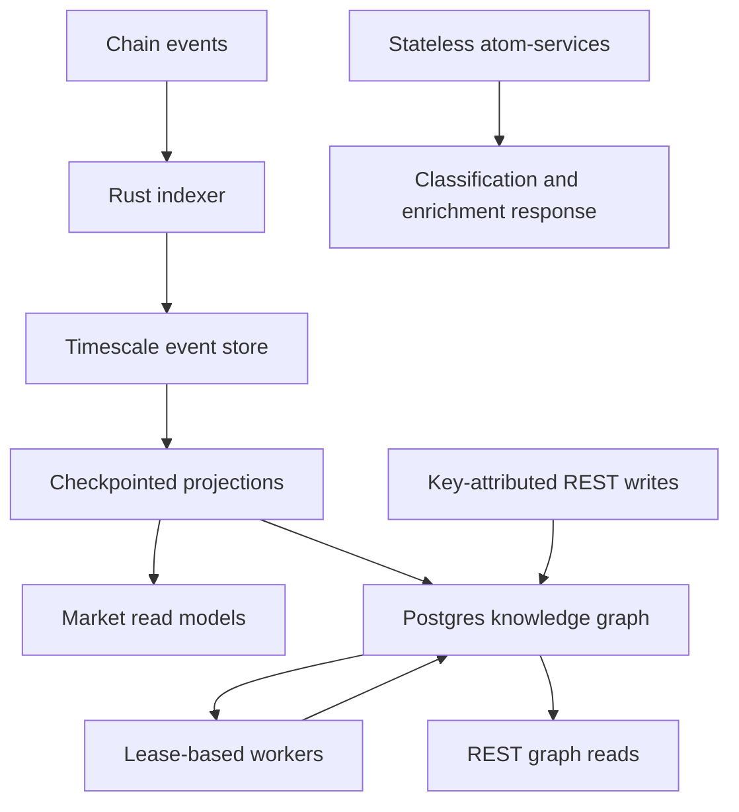

Use each layer for the work it owns. This keeps application code portable and makes an agent's integration choices reviewable.

| Layer                                                       | Owns                                                                   | Your application supplies                                    |
| ----------------------------------------------------------- | ---------------------------------------------------------------------- | ------------------------------------------------------------ |
| `iid-spec`, `iid`, `iid-registry`, `iid-ladder`, `ids`      | Identifier rules, pure resolution, selection policy, content IDs       | Input facts and reconciliation policy                        |
| `schema-org`, `classifications`, `predicates`, `primitives` | Vocabulary, creation fields, relationships, deterministic builders     | Forms, validation presentation, persistence decision         |
| `atom-parser`, `atom-classification`, `atom-enrichment`     | Reusable processing engines and plugins                                | Runtime mode, providers, credentials, cache, network policy  |
| Core                                                        | REST graph API, storage, workers, chain ingestion and projections      | Node configuration, access policy, operations                |
| `deployments`, `protocol`, `periphery`, `curves`            | Artifacts, contract helpers, encoding and quote math                   | Matching chain/deployment, clients, current state            |
| `sdk`, `cli`, `react`                                       | Integration reads/plans, deterministic command-line encoding, UI hooks | Signing policy, transaction UX, error recovery               |
| Main application                                            | Product flows and orchestration                                        | Its own auth, ranking, billing, moderation, and presentation |

## Core's two data paths

Postgres-KG stores atoms, triples, predicates, artifacts, accounts, and attribution. The event store and market projections track chain events, vaults, positions, and signals. Deterministic term IDs connect the models; there is no cross-database foreign key guaranteeing they advance together. The graph can be used without chain indexing.

Atom-services is a separate stateless HTTP service for classification/enrichment. Calling it does not persist a graph record. Running a package engine likewise does not start a worker, provision a database, or write a term.

## Public integration versus product internals

An application can derive WebPage identity from URL facts and attach extracted title/image to presentation data separately. A provider-backed picker can combine provider candidates with category identity policy. These patterns keep a metadata refresh from changing the target of existing relationships.

App-local routers, authentication packages, database actions, and UI models are not public SDK contracts. Third-party builders should use the [Core API](./guides/core-rest.md) and [public packages](./packages/index.md), then implement their own application adapter. The [creation guide](./guides/creation-profiles.md) shows the public imports for that adapter.

## Query surface selection

- **Core REST:** your node's atoms, triples, artifacts, pipeline state, events, and schema metadata.
- **SDK API client:** a narrow set of lookups over the hosted GraphQL schema, returning normalized models.
- **GraphQL documentation elsewhere on this site:** the established hosted schema; this does not imply Core hosts that schema.
- **Contract reads:** current protocol state at the selected RPC and block. These can lead indexed data.

A Core-native GraphQL contract is tracked as separate roadmap work. Do not send the SDK's generated GraphQL operations to `/api/atoms` or infer a new Core `/graphql` endpoint.

## Failure and consistency model

Keep separate UI states for a missing record, a pending projection, an enrichment failure, and a transaction revert. Use finite retries and observable status. Core's workers reclaim expired leases and maintain stage attempts; applications still need a timeout and recovery path. A provider timeout can leave identity and relationships intact.

[Core architecture source](https://github.com/0xIntuition/intuition-core/blob/eebba114666ba2373690f2beb7dce565aa16f0b7/docs/architecture.md).
