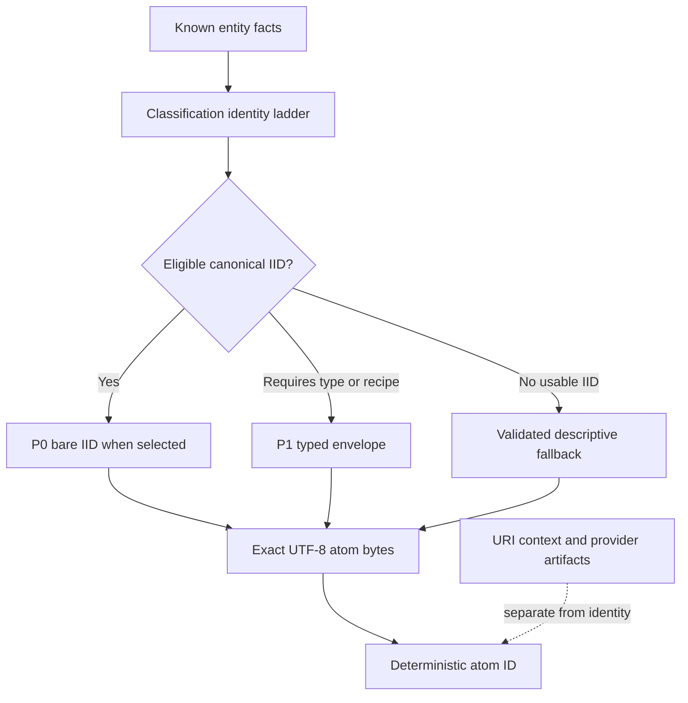

An application needs to distinguish the thing being described, its serialized representation, and the claims people make about it.

| Concept        | What it means                                                                | What it does not establish                                 |
| -------------- | ---------------------------------------------------------------------------- | ---------------------------------------------------------- |
| IID            | A canonical `int:<scheme>:<value>` identifier derived under registered rules | That an atom exists in a database or contract              |
| Atom data      | Exact bytes describing an entity or anchoring an IID                         | That every equivalent description has identical bytes      |
| Atom ID        | Deterministic protocol hash of those exact bytes                             | A mutable record identifier that survives payload edits    |
| Classification | Shared entity specification, such as `music-recording`                       | A guarantee that a provider's answer is correct            |
| Predicate      | An atom identifying a relationship, with shared semantic metadata            | A database column name or arbitrary UI label               |
| Triple         | Subject, predicate, and object term IDs forming a claim                      | An independently verified fact                             |
| URI context    | Ordered, validated references associated with an anchor                      | A component of the anchor's atom ID                        |
| Artifact       | A provider's processing output with provenance and status                    | New identity bytes that should overwrite the original atom |
| Vault          | Assets and shares for a term on a particular curve                           | A universal or objective truth score                       |

## Identity and representation profiles

An IID describes identity; the representation profile determines what bytes an atom stores. P0 uses an eligible canonical IID directly. P1 carries a typed envelope. P2 is the specification’s opt-in enriched representation: a typed identity envelope plus descriptive fields. The current anchor builder serializes the same identified envelope bytes for explicit P1 and P2 requests; requesting P2 does not automatically attach every descriptive input. Profile metadata is not itself serialized. This is a builder limitation to account for, not a redefinition of P2. See [representation and equivalence](./identity-resolution.md) before choosing a richer payload.

Use the package builder instead of reimplementing JSON ordering or normalization. Whitespace, property order, schema context spelling, and string forms can change an envelope's ID. Enriching a display label should not silently change its identity.

`inspectIntuitionId` reports validity and anchor eligibility separately. Bare Wikidata QIDs are polymorphic and cannot be bare P0 anchors. Active typed bindings such as `int:wd:film:Q188035` can be eligible. Class C (`gen1`), registered provider-local Class D identifiers, and weak account handles require richer representations. `candidateIid` is a distinct builder path with its own validation; it is not a general-purpose way to bypass the normal ladder.

## Ladders and aliases

An identity ladder tries stronger identifiers before weaker ones. The `iid` engine evaluates a declared classification ladder. `iid-ladder` projects provider/import inputs using category policy. They share rules but accept different input shapes.

An alias is useful evidence for matching. It need not be eligible as the primary identifier. A `sameAs` relationship or field is an assertion that an application must evaluate; it does not collapse IDs or automatically merge on-chain positions. Keep the identity candidates and provenance when reconciling duplicates.

## Relationships and context

A triple's subject and object refer to terms. Nested triples let applications make claims about claims. Predicates supply canonical payloads and IDs; classification metadata recommends meaningful targets. Recommendations in a form are not a protocol-level authorization policy.

The shared `I` subject is the literal UTF-8 string `I`, exported as `I_SUBJECT_ID` by `ids`. It supports patterns such as `I → follow → account`. Attribution belongs to the account creating or signaling on the claim; `I` is not a new identifier for each user.

## On-chain and off-chain state

A Core write creates an off-chain graph record. Registering identical atom bytes on-chain produces the same protocol ID, but requires a separate transaction. Core observes indexed events and updates its read model later. Transaction submission, successful receipt, indexing, projection, and enrichment are distinct states.

Signals and positions add economic context to claims. An application chooses how to rank or display that context. Preserve the account, term, curve, time, and source behind a ranking instead of presenting a balance as proof of truth.

For the exact profile rules, read the [pinned IID specification](https://github.com/0xIntuition/packages/blob/1dc7103d2a05f23bc565a81df4b001336ce9ba53/packages/iid-spec/explainer.md).
