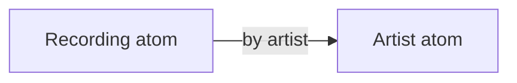

A knowledge graph describes entities and the relationships between them. In Intuition, an **atom** identifies a thing, a **triple** expresses a relationship, and a **signal** records an economic position on an atom or triple.

Imagine a music catalog. A recording and an artist are atoms. “This recording is by this artist” is a triple. People can add signals to the resulting terms through the protocol.

## Identify an entity

An atom is defined by its exact data bytes. The same bytes produce the same atom ID; changing those bytes changes the ID. Applications can therefore refer to the same atom without coordinating a database-generated key.

An **Intuition identifier (IID)** gives supported kinds of entities a canonical identity string. For example, a recording with ISRC `USRC17607839` has the IID `int:isrc:USRC17607839`. The [primitives package](./packages/primitives.md) can select that identity and turn it into atom bytes and an ID.

| Value                                    | What your application uses it for                  |
| ---------------------------------------- | -------------------------------------------------- |
| IID, such as `int:isrc:USRC17607839`     | Recognize an entity across imports and providers   |
| Atom data                                | The canonical representation to persist or publish |
| Atom ID                                  | Join graph records and address protocol terms      |
| Metadata, such as a title or cover image | Display and refresh information about the entity   |

Deriving an ID is a local calculation. The atom becomes a stored or on-chain record only when your application writes it to that destination.

## Describe relationships

A triple has three atom IDs: **subject**, **predicate**, and **object**. For a recording's artist, the recording is the subject, “by artist” is the predicate, and the artist is the object.

Predicates are atoms too. Use the [shared predicate vocabulary](./packages/predicates.md) so applications use the same bytes and IDs for the same relationship. A different predicate label or description can identify a different atom.

The triple ID is deterministic from its three IDs. Attribution, evidence, timestamps, and confidence describe a claim about that relationship; your storage or application must preserve them separately as appropriate.

## Add context without changing identity

A **classification** describes the kind of entity, such as `MusicRecording`. Classification specifications provide identity rules and form fields. **Enrichment** retrieves additional information from providers, such as an image or external reference.

Keep refreshable fields separate from canonical identity. Updating a cover image should update the displayed metadata, rather than create a new identity for the recording. Retain provenance so readers can tell which provider supplied a field.

Some entities have strong identifiers; others need a URL or a derived identity based on their fields. See [identity and representations](./identity-resolution.md) for selection rules, representation profiles, and handling equivalence between existing atoms.

## Add signals

The on-chain protocol associates terms with vaults. Deposits and redemptions change positions and express economic conviction. Their meaning in your product—ranking a recommendation, weighting a reputation score, or curating a list—is a design decision.

A shared ID makes records joinable. A signal makes a position observable. Neither alone establishes that a claim is true; explain how your application evaluates evidence and uses those positions.

Continue with [your first atom](./guides/first-atom.md), then [build a music catalog](./guides/music-catalog.md) to connect these concepts in code.
