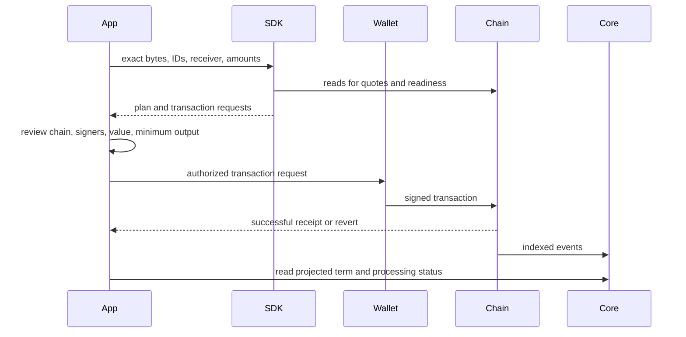

Use an explicit network, deployment, account, and budget. The candidate ABI includes functions that older deployments may not implement. Select the [matching release](../compatibility.md) before using URI-aware creation, FeeProxy routing, or dynamic-fee actions.

## The transaction lifecycle



A quote is a snapshot, not a reservation. Revalidate stale state before submission. A transaction hash is not a successful receipt, and a receipt is not proof that the chosen Core node has indexed it.

## Select an operation

| Task                                     | SDK action                                                  | Result                                                  |
| ---------------------------------------- | ----------------------------------------------------------- | ------------------------------------------------------- |
| Create atoms/triples and seed positions  | `multivaultCreateAndSeedTerm`                               | Ordered plan; despite the name, it does not submit      |
| Quote and prepare a deposit              | `multivaultQuoteDepositPlan`, `multivaultPrepareDepositTx`  | Fee details and transaction request                     |
| Quote and prepare redemption             | `multivaultQuoteRedeemPlan`, `multivaultPrepareRedeemTx`    | Redeem quote and request                                |
| Create with URI context through FeeProxy | `feeProxyPrepareCreateAtomsWithUrisTx`                      | Quote, calldata, value, and effective URI configuration |
| Check routed creation/deposit readiness  | `feeProxyGetReadiness`                                      | Requirements and readiness issues                       |
| Route a deposit or creation              | `feeProxyBuildDepositViaPlan`, `feeProxyBuildCreateViaPlan` | Signer-attributed steps                                 |
| Submit a FeeProxy plan                   | `feeProxyExecutePlan`                                       | Sends each step and waits for its receipt               |
| Prepare a pending refund claim           | `feeProxyClaimRefundIfAny`                                  | A transaction or `null`; it does not submit             |

See the [function reference index](../sdk-reference/index.md) for complete parameter and result types across MultiVault, FeeProxy, and refund actions. Import these functions from `@0xintuition/sdk/actions`; use `sdk/protocol` or `protocol` for low-level wrappers and encoders.

## Prepare an atom creation plan

This function takes a caller-configured MultiVault `WriteConfig`, a receiver, and an initial amount in base units. It prepares a plan and makes contract reads; it does not own signing or submit transactions.

```ts
import { buildIidAnchor } from '@0xintuition/primitives/anchor';
import { multivaultCreateAndSeedTerm } from '@0xintuition/sdk/actions';
import type { WriteConfig } from '@0xintuition/protocol';
import type { Address } from 'viem';

export async function prepareRecording(
  config: WriteConfig,
  receiver: Address,
  assetsIn: bigint,
) {
  const result = buildIidAnchor('music-recording', { isrc: 'USRC17607839' });
  if (!result.success) throw new Error(result.errors.join('; '));
  return multivaultCreateAndSeedTerm(config, {
    receiver,
    atomsToCreate: [
      {
        termId: result.value.id,
        data: result.value.dataHex,
        assetsIn,
      },
    ],
    seedDeposits: [],
  });
}
```

The caller must choose an amount that satisfies current contract costs and decide whether an existing term should be reused or funded. For context URIs, use the explicit URI-aware function instead of assuming this ordinary creation path registers them. Pass live URI limits to the anchor builder where applicable.

## Review the plan

Check every step's destination, chain, calldata, value, receiver, required signer, and ordering. Keep big integers in base units; format them only for display. Delegated operations can require a receiver's approval from a different account. `feeProxyExecutePlan` refuses a plan containing a step for another signer before sending anything. A later failure can still leave earlier mined steps completed: record their hashes and re-read state before resuming.

FeeProxy excess value is first pushed back; only a failed refund push credits the pull-refund ledger. `feeProxyClaimRefundIfAny` can therefore return `null` normally. Do not assume every routed operation leaves a claimable balance.

## React integration

`IntuitionProvider` sits inside wagmi and TanStack Query providers. `useTransactionFlow` handles submitting/confirming/confirmed/error states. Resetting it does not cancel a wallet request or chain transaction. The candidate's `useCreateAtomFlow` uses ordinary `createAtoms`; compose a URI-aware protocol call explicitly when context registration is required.

This recipe intentionally leaves transaction authorization to your application's wallet flow. The docs qualification process records test-environment evidence separately from source compilation.
