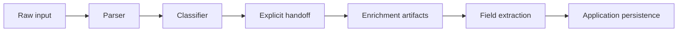

Parsing detects input structure. Classification proposes an entity type and publishable identity data. Enrichment obtains provider artifacts; extraction maps them to canonical classification fields. Your application decides what to persist and when to refresh it.

Use [atom-runtime](../packages/atom-runtime.md) to share engines and caches across requests, or compose [atom-classification](../packages/atom-classification.md) and [atom-enrichment](../packages/atom-enrichment.md) directly for a smaller plugin set. Follow [installation](./installation.md) first.



## Parse locally, including IIDs

```ts
import { parseAtom } from '@0xintuition/atom-parser';

const parsed = await parseAtom('int:isrc:US-RC1-76-07839', {
  remoteFetch: false,
});
if (parsed.kind === 'iid') {
  if (!parsed.valid || !parsed.canonicalIid) {
    throw new Error(parsed.reason ?? 'Invalid identifier');
  }
  console.log(parsed.canonicalIid, parsed.anchorEligible);
}
```

IID-shaped invalid inputs remain `kind: 'iid'` with `valid: false`; do not treat them as ordinary text. JSON objects can also carry structured-document candidates. `remoteFetch: false` prevents URL/IPFS inspection. With inspection enabled, the published Node transport validates resolved addresses and pins the connection on every redirect; custom transports must preserve that policy. See the [parser guide](../packages/atom-parser.md) for limits and errors.

## Classify with an explicit plugin set

This example runs locally and needs no provider credentials:

```ts
import {
  createClientEngine,
  createPlainTextPlugin,
  createTypeProfilesPlugin,
} from '@0xintuition/atom-classification';

const engine = createClientEngine({
  plugins: [createTypeProfilesPlugin(), createPlainTextPlugin()],
});
const controller = new AbortController();
const classified = await engine.classify(
  {
    input: 'An example idea',
    mode: 'client-only',
    classificationSessionId: 'docs-example',
  },
  { signal: controller.signal },
);
console.log(classified.resolved);
```

Plain text uses a generic `Thing` fallback. The lexical plugin is opt-in; arbitrary text no longer implies a `DefinedTerm`, `term:*` identifier, or Wiktionary link. Choose `client-only`, `progressive`, or `server-only` to match plugin capability and host execution. The canonical `classifications` catalog and runtime categories such as `song` remain different contracts.

## Connect classification to enrichment

The following is a **server recipe**. Replacing the sample with a provider URL can make network requests. Supply only the provider credentials your application enables.

```ts
import { createProcessingRuntime } from '@0xintuition/atom-runtime';
import { toClassifiedAtomInput } from '@0xintuition/atom-enrichment/handoff';

const runtime = createProcessingRuntime({
  env: {},
  cache: { provider: 'memory', memoryMaxEntries: 1000 },
});
const controller = new AbortController();
const deadline = setTimeout(() => controller.abort(), 15_000);
try {
  const rawInput = 'An example idea';
  const classified = await runtime.classification.engine().classify(
    {
      input: rawInput,
      mode: 'server-only',
      classificationSessionId: 'processing-example',
    },
    { signal: controller.signal },
  );
  const input = toClassifiedAtomInput(rawInput, classified);
  if (!input) {
    throw new Error(
      'No usable classification. Inspect the result before retrying.',
    );
  }
  const enriched = await runtime.enrichment
    .engine('default')
    .enrich({ runtime: 'server', input }, { signal: controller.signal });
  console.log({
    status: enriched.status,
    artifacts: enriched.artifacts,
    errors: enriched.errors,
    skipped: enriched.skipped,
  });
} finally {
  clearTimeout(deadline);
  controller.abort();
  runtime.dispose();
}
```

`toClassifiedAtomInput` preserves the classification's identity and provider hints. It returns `null` for unusable or terminal acquisition results. It treats bare IIDs as identifier-first inputs and does not invent a display name from the IID. Plain-text `Thing` input disables URL-only providers. Do not fabricate URL hints merely to force a provider to run.

In a long-lived server, create the runtime at service startup, scope cancellation to each request, and dispose at shutdown. Disposing does not cancel requests already in flight. The default preset selects a broad server provider bundle; use an explicit engine/plugin set when you want tighter capability control.

## Extract fields with provenance

The engine returns artifacts, not a replacement atom payload. Extract values for a canonical classification as a separate step:

```ts
import { extractClassificationFields } from '@0xintuition/atom-enrichment/extraction';
import type { EnrichmentArtifact } from '@0xintuition/atom-enrichment';

async function fieldsForRecording(artifacts: EnrichmentArtifact[]) {
  const result = await extractClassificationFields({
    classification: 'music-recording',
    artifacts,
    language: 'en',
  });
  return {
    values: result.values,
    provenance: result.fields,
    missingRequired: result.missingRequired,
    droppedFields: result.droppedFields,
  };
}
```

Extraction can perform additional lookups; supply `fetcher` and `signal` when you need controlled transport and cancellation. Keep each field's source, confidence, and evidence URL. A provider artifact is evidence, not independent verification of a claim. Persist presentation metadata separately from the canonical bytes used to derive an existing atom ID.

## Handle partial results and provider failures

| Result                                      | Application response                                                          |
| ------------------------------------------- | ----------------------------------------------------------------------------- |
| Invalid parse or boundary validation        | Explain the invalid input; do not retry unchanged input indefinitely          |
| Classification with no usable handoff       | Preserve diagnostics and let the caller refine the input                      |
| Partial enrichment                          | Keep useful artifacts alongside errors and skipped-provider reasons           |
| Missing credentials or incompatible runtime | Configure or disable the provider; do not expose credentials to the browser   |
| Timeout or cancellation                     | Stop queued work and retry only under your bounded scheduling policy          |
| Cached result                               | Preserve cache provenance and choose a refresh policy appropriate to the data |

`classifyOutcome` and `enrichOutcome` are available from the packages' `/outcome` entrypoints for the shared Promise outcome vocabulary. [pipeline-runtime](../packages/pipeline-runtime.md) supplies bounded concurrency and circuit breakers. Imported runtimes do not own your worker scheduler or persistence.

## Use Core's stateless service

The [documented Core service](../compatibility.md) exposes `POST /v1/classify` with `{ "input": "…" }`, and `POST /v1/process` with `{ "rawInput": "…" }`. Processing does not persist a graph record. This service uses local port 4010, separate from the Query API. Persist accepted results through the [Core REST guide](./core-rest.md).

## Extend the pipeline

Use the [plugin authoring guide](./processing-plugins.md) to implement a provider or classifier against public exports and fixture-test it before adding it to a preset.
