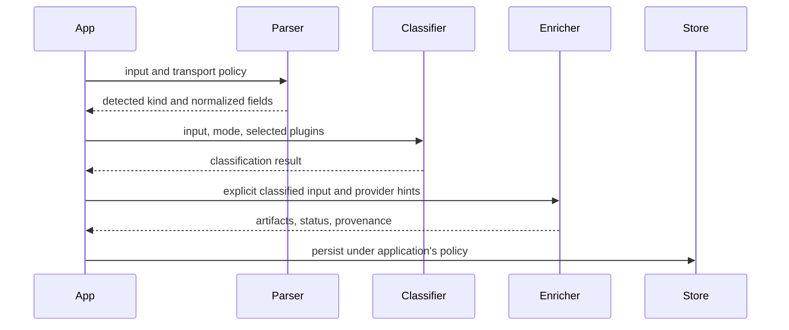

The processing stages answer different questions. Parsing detects input structure. Classification proposes an entity type under configured plugins. Enrichment obtains provider artifacts and normalized fields. Persistence, scheduling, and retries belong to Core or your application.



## Parse locally

```ts
import { parseAtom } from '@0xintuition/atom-parser';
const parsed = await parseAtom('https://example.com', { remoteFetch: false });
console.log(parsed.kind);
```

`remoteFetch: false` makes this example local. URL/IPFS remote inspection is enabled by default otherwise. The parser exposes timeouts and response limits, and rejects private literal addresses by default; it does not resolve/pin DNS or prevent DNS rebinding. Services handling untrusted URLs need network egress controls.

## Choose classification plugins

```ts
import {
  createClientEngine,
  createPlainTextPlugin,
  createTypeProfilesPlugin,
} from '@0xintuition/atom-classification';
const engine = createClientEngine({
  plugins: [createTypeProfilesPlugin(), createPlainTextPlugin()],
});
const classified = await engine.classify({
  input: 'An example idea',
  mode: 'client-only',
  classificationSessionId: 'docs-example',
});
console.log(classified);
```

The engine does not automatically enable every plugin. Choose `client-only`, `progressive`, or `server-only` according to the plugin's capability and your deployment. The `classifications` data package owns canonical entity specifications; the similarly named `atom-classification` package executes plugins.

## Enrich on the server

```ts
import {
  createEnrichmentEngine,
  createMemoryCacheAdapter,
  createOpenGraphPlugin,
} from '@0xintuition/atom-enrichment';
const engine = createEnrichmentEngine({
  plugins: [createOpenGraphPlugin()],
  cache: createMemoryCacheAdapter({ maxEntries: 1000 }),
});
const enriched = await engine.enrich({
  runtime: 'server',
  input: {
    atomType: 'thing',
    jsonLd: { '@context': 'https://schema.org', '@type': 'Thing' },
    hints: { url: 'https://example.com' },
    source: {
      classificationEngine: 'docs-example',
      classifiedAt: new Date().toISOString(),
    },
  },
});
console.log(enriched);
```

Unlike the earlier examples, this invokes an HTTP provider. Preserve provider status, source URI, and errors; do not claim a provider result was verified just because it was fetched. The registry's provider plan is only a list of capabilities. Intersect it with installed plugins, runtime support, and credentials before execution.

## Use Core's stateless service instead

Atom-services exposes `POST /v1/classify` with `{ "input": "…" }`, and `POST /v1/process` with `{ "rawInput": "…" }`. The payload keys differ. The latter classifies and enriches but does not write your node's graph. Its port is 4010 in the documented local setup, separate from the Query API.

## Contribute a plugin

Start with Core's [classification plugin guide](https://github.com/0xIntuition/intuition-core/blob/eebba114666ba2373690f2beb7dce565aa16f0b7/docs/writing-a-classification-plugin.md) or [enrichment plugin guide](https://github.com/0xIntuition/intuition-core/blob/eebba114666ba2373690f2beb7dce565aa16f0b7/docs/writing-an-enrichment-plugin.md). Use injected fixtures for provider failures, timeouts, missing credentials, and deterministic output. `atom-enrichment/testing` provides `runPluginConformanceSuite` for Node/Bun tests; do not include that test-only entrypoint in a browser bundle.
