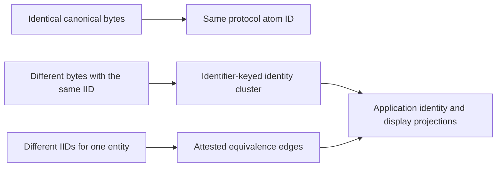

Two applications can agree on an entity while storing different descriptions of it. Shared identifiers and an equivalence layer address different parts of that problem.

## Three representation profiles

| Profile               | Payload                                                      | Use                                                             |
| --------------------- | ------------------------------------------------------------ | --------------------------------------------------------------- |
| P0 — anchor           | Exact eligible canonical IID string                          | Stable target for claims, with identical bytes across producers |
| P1 — identity context | Type, IID, identity recipe fields and corroborating evidence | Required context for derived or ambiguous identifiers           |
| P2 — enriched         | P1 plus descriptive fields                                   | Opt-in when descriptive data must travel in the atom payload    |

Adding descriptive fields changes atom bytes and can change the atom ID. For a stable anchor with refreshable presentation, keep provider artifacts separate. The current `buildIidAnchor` derivation path serializes the same identified envelope for explicit P1/P2 options; the option alone does not implement full descriptive P2 output. The `candidateIid` path also chooses its representation under its own eligibility rules. Read the exact [builder contract](./packages/primitives.md) before relying on either behavior.

## Three identity-resolution mechanisms

The first mechanism follows directly from deterministic hashing. The latter two describe the specification's equivalence architecture: matching embedded IIDs can group representations, while accepted `sameAs` edges can connect distinct identifiers for one entity. Candidate generation proposes edges for review; it is not permission to merge uncertain entities automatically.

**Implementation boundary:** the IID specification's equivalence chapter is informative and describes a layer above the identifier packages. The pure packages do not maintain clusters or acceptance thresholds, and this guide does not promise a cluster/election API in the inspected Core REST contract. Verify the selected backend's implemented projection before depending on those behaviors.

## Identity-canonical and display-canonical

The representation specification distinguishes a stable identity target from the richer member chosen for display. A P0 anchor, when available, provides a convergence point for new claims. A display representation can improve as better descriptions and attestations arrive.

The informative equivalence model also describes class/rung/creation-time tie-breaking and reversible accepted-edge projections. Those policies must be reconciled with the backend's actual election behavior before an application treats them as a supported API. Do not rewrite atoms or transfer positions as a side effect of a display choice.

## Implement an application policy

1. Preserve raw identity evidence, the canonical IID, exact atom bytes and ID.
2. Match exact IDs first; distinguish equal IIDs from cross-scheme candidates.
3. Keep suggested equivalence edges separate from accepted edges.
4. Record sources, attribution, confidence and disagreement.
5. Choose the identity target and display source explicitly.
6. Keep original claims, balances and positions attached to their original terms.
7. Make projection decisions reversible and observable.

A valid identifier is a claim about identity, not a certificate that its associated description is correct. Check digits catch malformed values; they do not establish truth. Applications can apply different acceptance policies to the same evidence.

[Normative representation profiles](https://github.com/0xIntuition/packages/blob/1dc7103d2a05f23bc565a81df4b001336ce9ba53/packages/iid-spec/spec/07-representation-profiles.md) · [Informative equivalence architecture](https://github.com/0xIntuition/packages/blob/1dc7103d2a05f23bc565a81df4b001336ce9ba53/packages/iid-spec/spec/08-equivalence.md).
