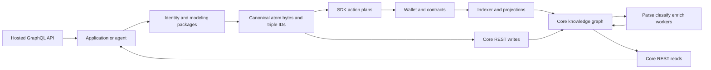

Intuition gives applications shared identifiers, a common vocabulary for relationships, a backend for processing and querying those relationships, and an on-chain protocol for publishing terms and expressing economic signals. You can start by modeling data entirely offline, persist it in a Core node, and add wallet interactions when your application needs them.

This guide covers the upcoming package release. The [compatibility manifest](./compatibility.md) pins the source revisions and package versions. Some npm versions and contract capabilities are release candidates; code in a checkout is not proof of a deployed service.

## Choose a first result

| You want to…                     | Start here                                          | Result                                                       |
| -------------------------------- | --------------------------------------------------- | ------------------------------------------------------------ |
| Give an entity a stable identity | [Build your first atom](./guides/first-atom.md)     | Canonical data, hex bytes, deterministic ID; no credentials  |
| Store and query a graph          | [Core REST cookbook](./guides/core-rest.md)         | Attributed off-chain atoms and triples in your node          |
| Build a creation form            | [Creation Profiles](./guides/creation-profiles.md)  | Fields and relationship suggestions from shared package data |
| Add metadata from providers      | [Processing and enrichment](./guides/processing.md) | Explicit classifications, artifacts, and provenance          |
| Prepare protocol actions         | [On-chain workflow](./guides/onchain.md)            | Reviewed transaction plans with chain, amounts, and receiver |
| Build with an agent              | [Agent integration contract](./agents.md)           | A bounded task, correct imports, and checkable outcomes      |

## How the systems fit

The hosted GraphQL API is a separate query contract. Do not assume a Core REST server implements it. An application can use either read surface, or adapt both deliberately.

## Why shared identity matters

Imagine a music discovery application and an independent reputation application. Both can derive the same canonical ISRC-based atom for a recording. Each application adds its own relationships and presentation without inventing a new identity for the recording. A Core node can enrich it from available providers, while contracts can register the same bytes and their associated vaults.

The opportunity is composable applications: curation and discovery, research graphs, portable collections, contextual reputation, and agents that explain which entities and evidence informed a result. Shared identifiers make joins possible. They do not establish that a claim is true, grant access to another node's private records, or make every node automatically replicate every fact.

See [application patterns](./application-patterns.md) for designs and the decisions each application still owns.
