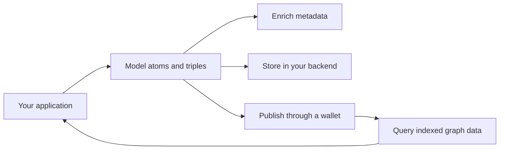

Build applications that identify the same entities, share relationships, and let people signal what they trust. Start with a small graph in your application, then add provider metadata, shared queries, or on-chain interactions as you need them.

These guides introduce the **Intuition V2 developer experience**. The libraries are published independently on npm; installation examples specify the exact alpha versions they use. See [versions and compatibility](./compatibility.md) when setting up or upgrading a project.

## Build your first graph

1. **[Understand the building blocks](./concepts.md).** Learn how atoms identify entities, triples connect them, and signals express conviction.
2. **[Create your first atom](./guides/first-atom.md).** Turn a recording identifier into canonical bytes and a deterministic ID. Run it locally with Node.
3. **[Build a music catalog](./guides/music-catalog.md).** Connect a recording to an artist, deduplicate imports, and keep display metadata separate from identity.

The first two code guides run offline. You can learn the data model before connecting a wallet or choosing a backend.

## Extend your application

| Your next feature            | Guide                                              | What you will build                                                       |
| ---------------------------- | -------------------------------------------------- | ------------------------------------------------------------------------- |
| Let users add entities       | [Create forms](./guides/creation-profiles.md)      | Fields and relationship suggestions from shared classification data       |
| Recognize and enrich inputs  | [Process and enrich atoms](./guides/processing.md) | A parser, classifier, and provider pipeline with explicit result handling |
| Display existing graph data  | [Query the graph](./guides/sdk-reads.md)           | Hosted API lookups by atom or triple ID                                   |
| Publish terms or add signals | [Prepare on-chain actions](./guides/onchain.md)    | Quotes and transaction requests for a wallet to review                    |
| Store your own graph         | [Persist with Core REST](./guides/core-rest.md)    | Attributed records in a self-hosted graph backend                         |

## Choose how to integrate

Your application chooses which steps it needs. Local identifiers are useful on their own. Enrichment adds context; persistence makes records available to readers; publishing and signaling add on-chain state. Each has a separate API and lifecycle.

Use **[Packages](./packages/index.md)** to choose libraries and look up their APIs. Use **[API reference](./sdk-reference/index.md)** for SDK function signatures. For architecture choices and complete application ideas, continue with [application architecture](./architecture.md) and [application patterns](./application-patterns.md).
