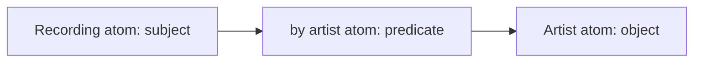

A knowledge graph describes entities and the relationships between them. In Intuition, an **atom** represents an entity with exact data bytes, a **triple** expresses a directed relationship, and a **signal** is an economic position associated with an atom or triple.

## Identify the thing and its representation

A recording and an artist are different entities. Each can have a canonical Intuition Identifier (IID), but the protocol's atom ID identifies a particular byte representation. Equal atom data produces the same atom ID; different descriptive payloads can refer to the same IID while producing different atom IDs.

| Value | Purpose |
| --- | --- |
| IID | Name an entity within an identifier scheme |
| Atom data | Persist the exact representation selected for that entity |
| Atom ID | Refer to that representation in triples and protocol operations |
| Companion context URIs | Publish discovery leads without changing the builder's atom data |
| Enrichment artifacts | Keep updatable descriptions and their provenance |

The [offline quickstart](/docs/get-started/quickstart) derives the golden ISRC fixture. It does not identify the synthetic recording used in the [music catalog](/docs/examples/music-catalog).

## State a relationship explicitly

A triple is an ordered tuple of subject, predicate, and object IDs. “Recording **by artist** artist” differs from the reversed tuple. A relationship field in JSON or a Creation Profile suggestion does not create either triple; your application must build the edge explicitly.

The [predicate registry](/docs/reference/packages/predicates) separates the application key, such as `byArtist`, from its label, serialized atom data, and atom ID. Use that shared definition rather than constructing a predicate from a label alone. Changing identity-bearing predicate data can create a different predicate atom.

## Add meaning and evidence

A **classification** describes an entity type. A **Creation Profile** supplies its input fields, identity ladder, and suggested relationships. Parsing recognizes inputs; classification plugins interpret them; enrichment retrieves additional fields from configured providers. A provider plan is a list of capabilities, not fetched evidence.

Keep descriptions, provider provenance, and application state separate from stable identity wherever possible. A valid identifier establishes syntax and derivation rules, not the truth of every associated claim. See [creation forms](/docs/build/creation-profiles) and [classification and enrichment](/docs/build/classify-enrich).

## Understand signals and storage

Protocol vaults associate shares and assets with a term on a particular curve. Deposits and redemptions change positions. Your application decides how those positions affect curation, reputation, or ranking.

Locally building a term creates no persistent record. An on-chain write requires submission and a successful receipt; a Core node must separately ingest and project events before its indexed records are visible. [Query a Core node](/docs/build/query-core) for the V2 read path.

## Continue with the concept pages

- [Representation profiles](/docs/concepts/representation-profiles): choose bytes for an IID and keep companion metadata separate.
- [Protocol writes](/docs/concepts/protocol-writes): distinguish local plans, RPC reads, wallet submission, and indexed visibility.

Source: [Core package concepts](https://github.com/0xIntuition/packages/blob/4e9af1373b81a453d16bc650983138e35afb97d1/README.md#core-concepts).
