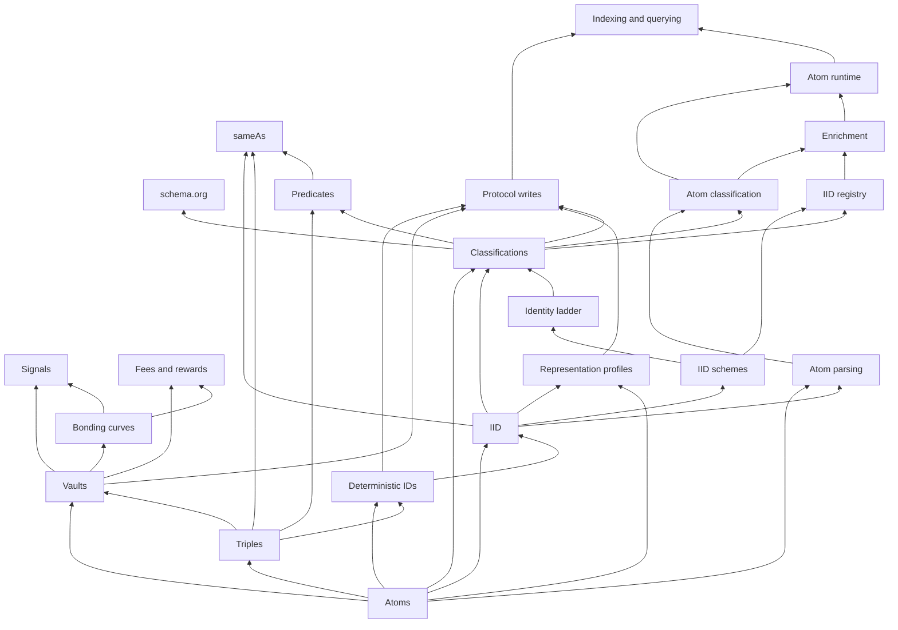

Choose a question to start with. To represent a recording and its artist, begin with atoms and triples. To decide whether a provider supplied enough evidence to display a title, follow the reading path to enrichment.

## How to read the map

Read each arrow from the prerequisite toward the concept that uses it. For example, a triple needs atoms for its subject, predicate, and object. The branches show where you can pursue a different question without finishing every page.

The shortest reading path to enrichment covers 11 pages.

[Atoms](/docs/concepts/atoms) → [Triples](/docs/concepts/triples) → [Deterministic IDs](/docs/concepts/deterministic-ids) → [IID](/docs/concepts/iid) → [IID schemes](/docs/concepts/iid-schemes) → [Identity ladder](/docs/concepts/identity-ladder) → [Classifications](/docs/concepts/classifications) → [IID registry](/docs/concepts/iid-registry) → [Atom parsing](/docs/concepts/atom-parsing) → [Atom classification](/docs/concepts/atom-classification) → [Enrichment](/docs/concepts/enrichment).

## Read by tier

### Tier 1 · Protocol primitives

[Atoms](/docs/concepts/atoms) represent entities as exact data bytes. [Triples](/docs/concepts/triples) express ordered relationships between terms. [Deterministic IDs](/docs/concepts/deterministic-ids) let a catalog derive the same identifiers from the same inputs before any write.

[Vaults, shares and positions](/docs/concepts/vaults) explain where deposits go. [Bonding curves](/docs/concepts/bonding-curves) explain what the next share costs. Continue to [Signals](/docs/concepts/signals) to interpret a position or [Fees, epochs and rewards](/docs/concepts/fees-and-rewards) to understand its economics.

### Tier 2 · Identity

[The Intuition Identifier](/docs/concepts/iid) names an entity independently of its atom representation. [Schemes and canonical form](/docs/concepts/iid-schemes) explain how to compare names. Use [Representation profiles](/docs/concepts/representation-profiles) to choose what bytes to publish and [The identity ladder](/docs/concepts/identity-ladder) to choose among candidate identifiers.

### Tier 3 · Meaning

[Classifications and Creation Profiles](/docs/concepts/classifications) describe what a recording is and what its form should collect. [schema.org vocabulary](/docs/concepts/schema-org) supplies shared types and properties. [Predicates](/docs/concepts/predicates) turn a relationship such as “by artist” into an explicit graph edge when used in a triple.

[The IID registry](/docs/concepts/iid-registry) connects identifier schemes to classification and provider plans. Use [sameAs and identity linking](/docs/concepts/same-as) when two distinct atoms represent the same entity.

### Tier 4 · Processing

[Atom parsing](/docs/concepts/atom-parsing) recognizes the form of an input. [Atom classification](/docs/concepts/atom-classification) interprets it using plugins. [Enrichment](/docs/concepts/enrichment) collects provider evidence and extracts supported fields. [Atom runtime and pipelines](/docs/concepts/atom-runtime) brings these stages into an application with explicit resource limits and cleanup.

### Tier 5 · Data flow

[Protocol writes](/docs/concepts/protocol-writes) separates planning, submission and receipt. [Indexing and querying](/docs/concepts/indexing-and-querying) follows the resulting chain events into a self-hosted Core node and its Query API. An off-chain insert can also put a recording into that node's graph.
