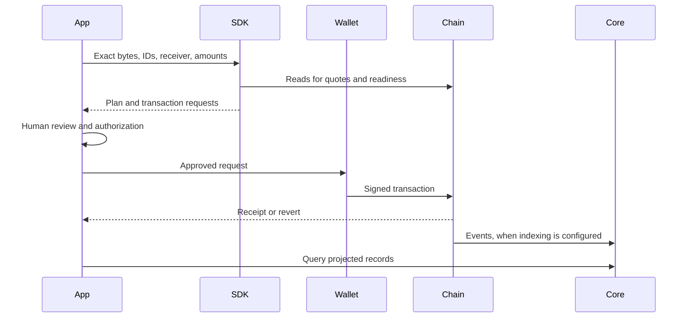

<AppliesTo />

A protocol write changes on-chain state through a signed transaction. Building atom bytes or an action envelope can happen locally; reading a quote needs contract state; submission requires an authorized signer. A prepared request is not a transaction, a transaction hash is not a successful receipt, and a receipt does not prove a Core node has indexed the change.

**Builds on:** [Deterministic IDs](/docs/concepts/deterministic-ids), [Vaults](/docs/concepts/vaults), [Representation profiles](/docs/concepts/representation-profiles), [Classifications](/docs/concepts/classifications).

**Implemented by:** [sdk](/docs/reference/packages/sdk), [protocol](/docs/reference/packages/protocol), [periphery](/docs/reference/packages/periphery), [deployments](/docs/reference/packages/deployments), [cli](/docs/reference/packages/cli).

## How it works



| Operation | Runtime boundary |
| --- | --- |
| Primitive builder, calldata encoder, client-free envelope | Local computation; envelope inputs include caller-supplied read context |
| SDK quote, readiness, or preparation action | May perform RPC reads; no submission merely because a plan is returned |
| Protocol write wrapper or `feeProxyExecutePlan` | Can simulate and submit using wallet clients |
| Receipt parsing | Confirms success or failure and filters expected contract events |
| Core query | Reads that node's projected state, which may lag chain confirmation |

A quote is a snapshot, not a reservation. Before signing, review the chain, deployment, calldata, value, receiver, required signer, minimum output, and ordered steps. Recheck stale state and deployment capabilities. [Contract artifacts](/docs/reference/compatibility#contract-artifacts-and-deployments) describe an interface, not a guarantee that every deployment implements it.

FeeProxy plans can route creation and deposits and require different signers for approvals. `feeProxyExecutePlan` submits and waits for receipts; a later failure can leave earlier steps completed. Record those receipts and reread state before resuming. A refund helper can return `null` when nothing is claimable.

## Example

This helper builds an ordinary descriptive atom and asks the SDK for a create-and-seed plan. **Calling it makes contract reads; it does not submit.** Its caller supplies a configured MultiVault, receiver, name, and amount in base units.

{/* example:start examples/v2/first-write/src/orientation.ts#prepare */}

```ts
import { buildThing } from '@0xintuition/primitives';
import { multivaultCreateAndSeedTerm } from '@0xintuition/sdk/actions';
import type { WriteConfig } from '@0xintuition/protocol';
import { stringToHex, type Address } from 'viem';

export async function prepareNamedAtom(
  config: WriteConfig,
  receiver: Address,
  name: string,
  assetsIn: bigint,
) {
  const result = buildThing({ name });
  if (!result.success) throw new Error(result.errors.join('; '));
  return multivaultCreateAndSeedTerm(config, {
    receiver,
    atomsToCreate: [
      {
        termId: result.value.id,
        data: stringToHex(result.value.data),
        assetsIn,
      },
    ],
    seedDeposits: [],
  });
}
```

{/* example:end */}

The caller must handle an existing atom and current creation costs. The same name and serialized data produce the same ID; deriving it does not reserve it. This ordinary creation plan does not register companion URIs. Use `multiVaultCreateAtomsWithUris` or a URI-aware FeeProxy preparation path when those entries must be registered, after reading live URI limits.

## Common mistakes

- Assuming a helper's name proves it submits: `multivaultCreateAndSeedTerm` returns a plan.
- Calling a write wrapper while intending only an offline preview.
- Treating a transaction hash as a receipt or a receipt as indexed visibility.
- Assuming a hook reset cancels a pending wallet request or transaction.
- Treating an off-chain Core API insert as on-chain registration.

## Next

[Build action plans and envelopes](/docs/build/action-plans) for review. After confirmation, [Indexing and querying](/docs/concepts/indexing-and-querying) explains how the write becomes visible to readers who [query a Core node](/docs/build/query-core). Its default source stack requires explicit indexing configuration before it ingests chain events.

Sources: [Action-plan ownership](https://github.com/0xIntuition/packages/blob/4e9af1373b81a453d16bc650983138e35afb97d1/packages/sdk/docs/action-plans.md), [MultiVault actions](https://github.com/0xIntuition/packages/blob/4e9af1373b81a453d16bc650983138e35afb97d1/packages/sdk/src/actions/multivault.ts), [FeeProxy execution](https://github.com/0xIntuition/packages/blob/4e9af1373b81a453d16bc650983138e35afb97d1/packages/sdk/src/actions/fee-proxy.ts).
