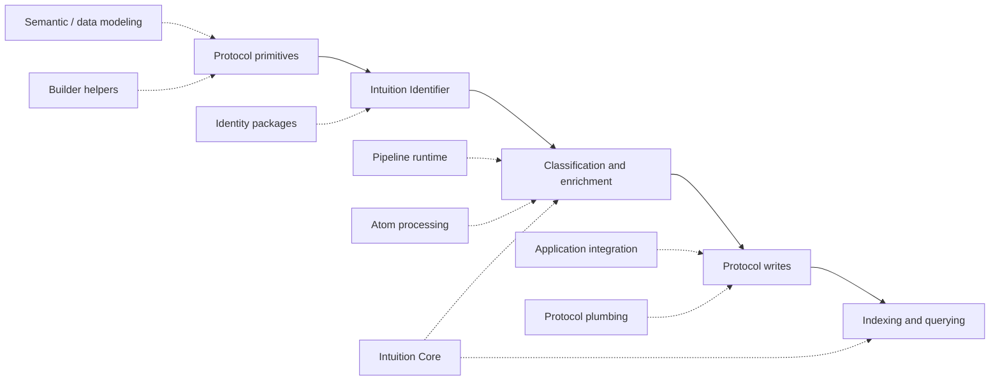

A music catalog can identify a recording, describe its artist, register their relationship, and read it back from a node. Different parts of Intuition handle each step. The packages handle local modeling and protocol operations. Intuition Core builds and serves the indexed graph.

## How it works

On the concept ladder, Protocol primitives form Tier 1, Intuition Identifier belongs to Tier 2 (Identity), Classification and enrichment span Tiers 3 and 4 (Meaning and Processing), and Protocol writes and Indexing and querying form Tier 5 (Data flow).

### Start with exact data

A recording is an entity. Its atom contains the bytes of a particular representation. A P0 anchor stores canonical IID text, while a contextual representation stores a JSON object. Hashing the exact atom data produces its atom ID. Persist the bytes and ID together so later metadata updates do not silently create a different term.

The catalog represents its relationship as recording → **by artist** → artist. The predicate is itself an atom. Its registry key selects a definition, and its serialized data determines its ID. A field named `artist` in a recording object does not create a triple, and reversing subject and object changes the statement.

### Choose packages by responsibility

| Layer | Packages | Responsibility |
| --- | --- | --- |
| Semantic / data modeling | `schema-org`, `classifications`, `predicates` | Shared vocabulary, input fields, and relationship suggestions |
| Identity | `iid-spec`, `iid`, `iid-registry`, `iid-ladder`, `ids` | Identifier rules, candidate selection, provider plans, and deterministic IDs |
| Builder helpers | `primitives` | Build atom data and explicit triples |
| Pipeline runtime | `pipeline-runtime` | Concurrency, cancellation, and circuit breaking |
| Atom processing | `atom-parser`, `atom-classification`, `atom-enrichment`, `atom-runtime` | Parse inputs, run plugins, and execute configured providers |
| Application integration | `sdk`, `cli` | Prepare actions, serializable envelopes, and calldata |
| Protocol plumbing | `protocol`, `deployments`, `periphery`, `curves`, `react` | Contract calls, deployment metadata, curve math, and hooks |

For a recording, the identity layer can plan a provider lookup from an IID. The atom processing layer executes selected adapters, checks their artifacts, and extracts supported fields. The app decides what evidence to display. See the package relationships in the [runtime dependency graph](https://github.com/0xIntuition/packages/blob/4e9af1373b81a453d16bc650983138e35afb97d1/docs/architecture/dependency-graph.md).

### Add persistence and transactions deliberately

Local modeling needs no chain or Core node. RPC reads inspect a selected contract's current state. Preparing an action may use those reads. Submitting it requires an authorized signer. A transaction hash, a successful receipt, and visibility in an index are three different results.

Fork and clone Intuition Core to build your own node from the pinned source. The default Compose stack starts its off-chain API and processing services. Enable the indexing profile and configure the chain and MultiVault deployment for ingestion and projections. Once projections catch up, read the recording and its relationships from your node's Query API. An authenticated off-chain API insert writes to that node independently of a chain transaction. [Core architecture](https://github.com/0xIntuition/intuition-core/blob/a402f880600f92969dc8fb013ca0f69fc9a02420/docs/architecture.md), [Query a Core node](/docs/build/query-core).

Keep provider secrets on your server. Your application owns access control, evidence acceptance, ranking, and the meaning it assigns to vault positions. A shared ID or a large position does not establish that a claim is true.

## Related

- [Concept map](/docs/concepts) links every tier and the shortest reading path to enrichment.
- [Offline quickstart](/docs/get-started/quickstart) proves identity and companion-context invariance.
- [Package reference](/docs/reference/packages) gives public imports and runtime requirements.
- [Protocol writes](/docs/concepts/protocol-writes) separates planning, signing, and observation.
- [Compatibility](/docs/reference/compatibility) covers peers, contract artifacts, and the pinned Core source.

Source: [Package layers](https://github.com/0xIntuition/packages/blob/4e9af1373b81a453d16bc650983138e35afb97d1/README.md#package-layers).
