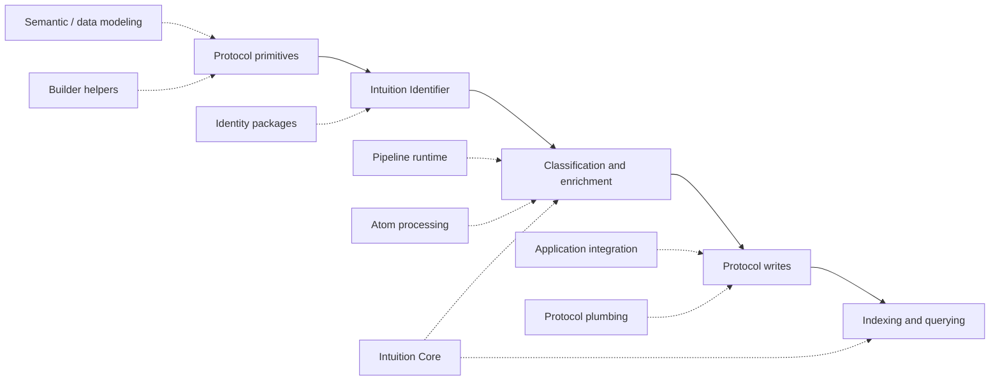

An Intuition application starts with the entity it wants to represent and the relationships it wants to assert. Public packages construct and interpret data; your application chooses storage, provider policy, authorization, and presentation.

## How it works

Protocol primitives is ladder Tier 1, Intuition Identifier is Tier 2 (Identity), Classification and enrichment spans Tiers 3 and 4 (Meaning, Processing), and Protocol writes and Indexing and querying are Tier 5 (Data flow).

### Start with exact data

A recording is an entity; its atom is a particular representation. A P0 anchor stores canonical IID text, while a contextual representation stores a JSON object. Hashing the exact atom data produces its atom ID. Persist the bytes and ID together so later metadata updates do not silently create a different term.

A relationship is explicit: recording → **by artist** → artist. The predicate is itself an atom. Its registry key selects a definition; its serialized data determines its ID. A field named `artist` in a recording object does not create a triple, and reversing subject and object changes the statement.

### Choose packages by responsibility

| Layer | Packages | Responsibility |
| --- | --- | --- |
| Semantic / data modeling | `schema-org`, `classifications`, `predicates` | Shared vocabulary, input fields, and relationship suggestions |
| Identity | `iid-spec`, `iid`, `iid-registry`, `iid-ladder`, `ids` | Identifier rules, candidate selection, provider plans, and deterministic IDs |
| Builder helpers | `primitives` | Build atom data and explicit triples |
| Pipeline runtime | `pipeline-runtime` | Concurrency, cancellation, and circuit breaking |
| Atom processing | `atom-parser`, `atom-classification`, `atom-enrichment`, `atom-runtime` | Parse inputs, run plugins, and execute configured providers |
| Application integration | `sdk`, `cli` | Prepare actions, serializable envelopes, and calldata |
| Protocol plumbing | `protocol`, `deployments`, `periphery`, `curves`, `react` | Contract calls, deployment metadata, curve math, and hooks |

These are responsibility groups. The [runtime dependency graph](https://github.com/0xIntuition/packages/blob/4e9af1373b81a453d16bc650983138e35afb97d1/docs/architecture/dependency-graph.md) shows actual package dependencies. Importing a package does not start a worker or fetch provider data.

### Add persistence and transactions deliberately

Local modeling needs no chain or Core node. RPC reads inspect a selected contract's current state. Preparing an action may use those reads; submitting it requires an authorized signer. A transaction hash, a successful receipt, and visibility in an index are three different results.

[Core's architecture](https://github.com/0xIntuition/intuition-core/blob/a402f880600f92969dc8fb013ca0f69fc9a02420/docs/architecture.md) adds durable storage, event ingestion, projections, processing workers, and the Query API. Its source Compose workflow starts the API and processing services; chain ingestion requires the indexing profile and explicit chain configuration. Read the indexed graph through [a Core node you run](/docs/build/query-core). An authenticated off-chain API insert is separate from a chain transaction.

Keep provider secrets on your server. Your application owns access control, evidence acceptance, ranking, and the meaning it assigns to vault positions. A shared ID or a large position does not establish that a claim is true.

## Related

- [Building blocks](/docs/concepts) explains atoms, triples, and signals.
- [Offline quickstart](/docs/get-started/quickstart) proves identity and companion-context invariance.
- [Package reference](/docs/reference/packages) gives public imports and runtime requirements.
- [Protocol writes](/docs/concepts/protocol-writes) separates planning, signing, and observation.
- [Compatibility](/docs/reference/compatibility) covers peers, contract artifacts, and the pinned Core source.

Source: [Package layers](https://github.com/0xIntuition/packages/blob/4e9af1373b81a453d16bc650983138e35afb97d1/README.md#package-layers).
