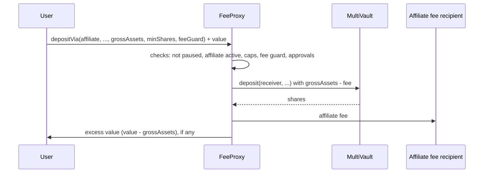

# FeeProxy.sol

FeeProxy lets an app (an **affiliate**) route a user's deposits and atom/triple creation to the [MultiVault](/docs/intuition-smart-contracts/multivault) and keep a fee for itself. Referral apps, social-trading apps and any other front end can use it to earn from the activity they bring to the protocol, without custody of user funds.

The user stays the owner of record:

- On a deposit, MultiVault mints the shares to the receiver the user picks, normally the user.
- On creation, MultiVault records the user as the creator of each atom and triple, not FeeProxy and not the affiliate.
- Redemptions do not go through FeeProxy. Users always redeem directly on MultiVault, so no affiliate can stand between a holder and their exit.

FeeProxy is one contract shared by all affiliates. Any address can register as an affiliate, set its own fees within protocol caps, and start routing calls.

:::info Availability
FeeProxy needs the v1.1.0 MultiVault (`createAtomsFor`, `createTriplesFor` and the CREATION approval). It goes live on each network after that network's MultiVault upgrade. See [Deployments](#deployments).
:::

## How a routed call works



1. The user sends `grossAssets` (or more) as `msg.value`.
2. FeeProxy computes the affiliate fee and forwards `grossAssets - fee` to MultiVault in the user's name.
3. After MultiVault returns, FeeProxy pays the fee to the affiliate's fee recipient.
4. FeeProxy returns any value above `grossAssets` to the caller.

The call is atomic. If MultiVault reverts (slippage, a minimum deposit, a duplicate atom, and so on), or the fee payment to the recipient fails, the whole transaction reverts: no fee is paid and the user keeps their funds. FeeProxy pays the affiliate only after the MultiVault call has returned, so the fee recipient cannot act before the user's operation and change its price.

## Fee model

Each affiliate has a **deposit-side** and a **creation-side** fee. Each side has a percentage part (basis points, `1 bps = 0.01%`) and a flat part (in TRUST wei):

```solidity
struct FeeConfig {
    uint256 depositBps;       // % of gross on depositVia / depositBatchVia
    uint256 creationBps;      // % of gross on createAtomsVia / createAtomsWithUrisVia / createTriplesVia
    uint256 depositFixedFee;  // flat fee per deposit call (TRUST wei)
    uint256 creationFixedFee; // flat fee per creation call (TRUST wei)
}
```

The fee for one call is:

```text
affiliateFee    = grossAssets * bps / 10_000 + fixedFee
forwardedAssets = grossAssets - affiliateFee
```

- The fee comes **out of** `grossAssets`. It is not added on top. `msg.value` must be at least `grossAssets`.
- The fee must be strictly less than `grossAssets`. Otherwise the call reverts with `FeeProxy_FeeExceedsGross`.
- **Batch and multi-term calls charge the fee once per call**, on the sum of all legs: one percentage cut plus one flat fee, not one per atom, triple or vault. FeeProxy then splits the forwarded total across legs in proportion to each leg's gross amount. Rounding dust goes to the last leg.
- Every leg must be non-zero, and each forwarded leg must still meet MultiVault's own requirements (minimum deposit, atom or triple cost). A leg that falls short reverts the whole call. An atom or triple that receives exactly 1 wei above its creation cost can also revert: when more than one MultiVault fee applies, each rounds up to 1 wei and together they exceed it. Check such a deposit with MultiVault's preview first.
- `minShares` is passed to MultiVault unchanged, so it applies to the **post-fee** amount. Size it for `forwardedAssets`, not `grossAssets`.

### Protocol caps

Three protocol-level values bound what affiliates can do. All three are storage values that the admin can change, and you can read them on-chain:

| Getter              | Meaning                                                                            |
| ------------------- | ---------------------------------------------------------------------------------- |
| `maxFeeBps()`       | Highest `depositBps` / `creationBps` an affiliate can set. Never above `10_000`.   |
| `maxFixedFee()`     | Highest `depositFixedFee` / `creationFixedFee` an affiliate can set, in TRUST wei. |
| `registrationFee()` | Exact TRUST amount `registerAffiliate` requires. It goes to the protocol treasury. |

FeeProxy checks the caps when an affiliate registers or updates its fees, and again on every routed call. If the admin lowers a cap, an affiliate whose fee is now above it cannot route on that side (deposit or creation) until it brings its fee under the new cap. The other side keeps working.

### Fee guard (front-run protection)

An affiliate can change its fees at any time. To make sure a user never pays more than they were shown, every routing call takes a `FeeGuard`:

```solidity
struct FeeGuard {
    uint256 maxFeeBps;   // highest bps the caller accepts for this call
    uint256 maxFixedFee; // highest flat fee the caller accepts for this call
}
```

FeeProxy compares the affiliate's **configured** rate for the side being used (deposit or creation) against these limits. If either is higher, the call reverts with `FeeProxy_BpsExceedsCallerGuard` or `FeeProxy_FixedFeeExceedsCallerGuard`. Front ends should read the affiliate's current fees, show them to the user, and pass those same values as the guard.

## Becoming an affiliate

Register from the address that will be the affiliate's identity. That address is the key in the registry: users and front ends pass it as `affiliate` on every routed call.

```solidity
function registerAffiliate(FeeConfig calldata fees, address feeRecipient)
    external payable returns (address affiliate);
```

- `msg.value` must equal `registrationFee()` exactly. Underpaying or overpaying reverts with `FeeProxy_RegistrationFeeMismatch`.
- All four fee fields must be within the current caps.
- `feeRecipient` receives the affiliate's fees. It can be a different address from the affiliate, for example a multisig. It cannot be the zero address.
- One registration per address. A registered row cannot be overwritten and there is no deregistration. To stop earning fees, set the fees to zero or stop sending users through the affiliate.

After registering, the affiliate address can change its own row at any time:

| Function                                   | Effect                                                                               |
| ------------------------------------------ | ------------------------------------------------------------------------------------ |
| `updateAffiliateFees(FeeConfig fees)`      | Replaces the whole fee config. The new values must be within the caps on both sides. |
| `updateFeeRecipient(address feeRecipient)` | Changes where fees go.                                                               |

Both still work while the affiliate is paused and while the whole contract is paused, so an affiliate can fix its row before routing resumes.

:::warning Fee recipient must accept TRUST
FeeProxy sends the fee to `feeRecipient` during each routed call. If that transfer fails (for example, a contract whose `receive` reverts), every routed call through the affiliate reverts. Fees with a value of zero are not sent, so a zero-fee affiliate is not affected.
:::

## User side: approve FeeProxy on MultiVault

FeeProxy acts in the user's name on MultiVault, so the user approves it once, on **MultiVault**, with `MultiVault.approve(sender, approvalType)`:

| `approvalType`         | Value | Needed for                                                     |
| ---------------------- | ----- | -------------------------------------------------------------- |
| `DEPOSIT`              | `1`   | `depositVia`, `depositBatchVia`                                |
| `CREATION`             | `4`   | `createAtomsVia`, `createAtomsWithUrisVia`, `createTriplesVia` |
| `DEPOSIT_AND_CREATION` | `5`   | All routed calls                                               |
| `NONE`                 | `0`   | Revokes the approval                                           |

FeeProxy never needs `REDEMPTION`. Do not grant it.

:::warning Approvals replace, they do not add
`approve` stores the new type in place of the old one. If a user approved `DEPOSIT` and then calls `approve(feeProxy, CREATION)`, the `DEPOSIT` approval is gone. To allow both, use `DEPOSIT_AND_CREATION` (`5`). Check the current state with `MultiVault.isApprovedToDeposit(feeProxy, user)` and `MultiVault.isApprovedToCreate(feeProxy, user)` before asking for a new approval.
:::

The approval stays in place until the user revokes it with `approve(feeProxy, NONE)`. It does not let other people spend the user's funds: every routed call is paid from the caller's own `msg.value`, and FeeProxy enforces these rules:

- **Deposits:** the receiver must have approved FeeProxy for `DEPOSIT`. If the receiver is not the caller, the receiver must also have approved the caller for `DEPOSIT`. Otherwise the call reverts with `FeeProxy_ProxyNotApprovedForDeposit` or `FeeProxy_ReceiverNotApproved`.
- **Creation:** the caller is always the creator of record, and the caller must have approved FeeProxy for `CREATION`. Otherwise the call reverts with `FeeProxy_ProxyNotApprovedForCreation`.

FeeProxy has no relayer or gas-sponsorship support: the user submits routed calls from their own wallet.

## Entry points

All routing calls are `payable`, take an `affiliate` address and a `FeeGuard`, and revert if the contract is paused or the affiliate is not registered or is paused.

### Deposits

```solidity
function depositVia(
    address affiliate,
    address receiver,
    bytes32 termId,
    uint256 curveId,
    uint256 grossAssets,
    uint256 minShares,         // applies to the post-fee amount
    FeeGuard calldata feeGuard
) external payable returns (uint256 shares);

function depositBatchVia(
    address affiliate,
    address receiver,
    bytes32[] calldata termIds,
    uint256[] calldata curveIds,
    uint256[] calldata grossAssets, // per vault, pre-fee
    uint256[] calldata minShares,   // per vault, post-fee
    FeeGuard calldata feeGuard
) external payable returns (uint256[] memory shares);
```

Both use the affiliate's deposit-side fee. `depositBatchVia` calls `MultiVault.depositBatch` once with the post-fee amount for each vault.

### Creation

```solidity
function createAtomsVia(
    address affiliate,
    bytes[] calldata atomDatas,
    uint256[] calldata grossAssets, // per atom, pre-fee
    FeeGuard calldata feeGuard
) external payable returns (bytes32[] memory termIds);

function createAtomsWithUrisVia(
    address affiliate,
    bytes[] calldata atomDatas,
    uint256[] calldata grossAssets,
    bytes[][] calldata uris,         // per-atom creation-time context
    FeeGuard calldata feeGuard
) external payable returns (bytes32[] memory termIds);

function createTriplesVia(
    address affiliate,
    bytes32[] calldata subjectIds,
    bytes32[] calldata predicateIds,
    bytes32[] calldata objectIds,
    uint256[] calldata grossAssets,  // per triple, pre-fee
    FeeGuard calldata feeGuard
) external payable returns (bytes32[] memory termIds);
```

These use the affiliate's creation-side fee and call `MultiVault.createAtomsFor`, `MultiVault.createAtomsWithUris` and `MultiVault.createTriplesFor` with the caller as creator. Each atom or triple's post-fee share must cover MultiVault's atom or triple cost (`getAtomCost()` / `getTripleCost()`).

### Refunds

Any `msg.value` above the gross total goes back to the caller in the same transaction. If that transfer fails (for example, a smart-contract wallet that cannot receive TRUST), the routed call still succeeds and the amount is credited to the caller in a refund ledger (`RefundCredited` event).

```solidity
function pendingRefund(address user) external view returns (uint256);
function claimRefund() external returns (uint256 amount);                           // pays msg.sender
function claimRefundTo(address payable recipient) external returns (uint256 amount); // pays recipient
```

Only the address that was credited can claim. A wallet that cannot receive TRUST should use `claimRefundTo` with an address that can. `recipient` cannot be the zero address or FeeProxy itself. Both claim functions work while the contract is paused.

To avoid refunds entirely, send `msg.value` equal to the gross total.

### Views

| Function                                            | Returns                                                                                                                |
| --------------------------------------------------- | ---------------------------------------------------------------------------------------------------------------------- |
| `isAffiliateRegistered(affiliate)`                  | `true` if the address has registered.                                                                                  |
| `isAffiliateActive(affiliate)`                      | `true` if registered and not paused. This is the check every routed call makes.                                        |
| `affiliateConfig(affiliate)`                        | The full row: `fees`, `feeRecipient`, `registeredAt`, `paused`.                                                        |
| `previewDepositFee(affiliate, grossAssets)`         | `(affiliateFee, forwardedAssets)` with the deposit-side fee.                                                           |
| `previewCreationFee(affiliate, grossAssets)`        | `(affiliateFee, forwardedAssets)` with the creation-side fee.                                                          |
| `affiliateStats(affiliate)`                         | Totals for the affiliate: transactions, unique users, gross, fees, forwarded, each also split by deposit and creation. |
| `affiliateUserStats(affiliate, user)`               | The same totals for one user of one affiliate.                                                                         |
| `maxFeeBps()`, `maxFixedFee()`, `registrationFee()` | Current protocol caps and registration fee.                                                                            |
| `multiVault()`, `treasury()`                        | Connected MultiVault and the treasury that receives registration fees.                                                 |

The preview functions only do the fee arithmetic. They do not check that the affiliate is registered, active or within the caps; an unregistered affiliate previews as a zero fee. Check `isAffiliateActive` as well before you quote a fee to a user.

The stats count each successful routed call once, so a batch is one transaction. `uniqueUsers` counts distinct callers, not share receivers. Reverted calls are never counted.

## Operations

### Roles

| Role                 | Can call                                                                                                          |
| -------------------- | ----------------------------------------------------------------------------------------------------------------- |
| `DEFAULT_ADMIN_ROLE` | `setMaxFeeBps`, `setMaxFixedFee`, `setRegistrationFee`, `unpause`, `unpauseAffiliate`, and grant or revoke roles. |
| `PAUSER_ROLE`        | `pause`, `pauseAffiliate`.                                                                                        |

At deployment, the admin receives both roles. Unpausing needs the admin role on purpose: a pauser can stop the contract or an affiliate, but cannot restart either on its own.

Affiliates need no role. They manage only their own row.

### Pausing

|             | Global pause (`pause`)                                                                                     | Affiliate pause (`pauseAffiliate`)                     |
| ----------- | ---------------------------------------------------------------------------------------------------------- | ------------------------------------------------------ |
| Blocks      | `registerAffiliate` and all five routing calls                                                             | Routing calls through that one affiliate               |
| Still works | `claimRefund`, `claimRefundTo`, `updateAffiliateFees`, `updateFeeRecipient`, admin setters, pause controls | Everything else, including the affiliate's own updates |
| Reversed by | `unpause` (admin)                                                                                          | `unpauseAffiliate` (admin)                             |

Neither pause affects positions on MultiVault: users redeem directly on MultiVault at all times. Unpausing an affiliate does not re-check its fees against the caps; if a cap was lowered in the meantime, the affiliate must update its fees before routing works again.

### Events

| Event                                                                                                   | Emitted when                                                                           |
| ------------------------------------------------------------------------------------------------------- | -------------------------------------------------------------------------------------- |
| `AffiliateRegistered(affiliate, feeRecipient, fees, registrationFee)`                                   | An affiliate registers.                                                                |
| `RegistrationFeeForwarded(treasury, registrationFee)`                                                   | A non-zero registration fee is sent to the treasury.                                   |
| `AffiliateFeesUpdated(affiliate, previous, current)`                                                    | An affiliate changes its fees.                                                         |
| `AffiliateFeeRecipientUpdated(affiliate, previous, current)`                                            | An affiliate changes its fee recipient.                                                |
| `AffiliatePaused(affiliate)` / `AffiliateUnpaused(affiliate)`                                           | An affiliate is paused or unpaused.                                                    |
| `DepositedVia(user, affiliate, termId, grossAssets, affiliateFee, forwardedAssets, shares)`             | A `depositVia` call succeeds.                                                          |
| `DepositedBatchVia(user, affiliate, totalGrossAssets, affiliateFee, totalForwardedAssets)`              | A `depositBatchVia` call succeeds.                                                     |
| `CreatedAtomsVia(user, affiliate, totalGrossAssets, affiliateFee, totalForwardedAssets, atomCount)`     | A `createAtomsVia` or `createAtomsWithUrisVia` call succeeds.                          |
| `CreatedTriplesVia(user, affiliate, totalGrossAssets, affiliateFee, totalForwardedAssets, tripleCount)` | A `createTriplesVia` call succeeds.                                                    |
| `AffiliateFeePaid(affiliate, user, affiliateFee)`                                                       | After each routed call, including with `affiliateFee = 0`.                             |
| `RefundCredited(user, amount)`                                                                          | An excess-value refund could not be sent and was credited to the ledger.               |
| `RefundClaimed(user, amount)`                                                                           | A ledger refund is claimed. `user` is the credited address, even with `claimRefundTo`. |
| `MaxFeeBpsUpdated`, `MaxFixedFeeUpdated`, `RegistrationFeeUpdated`                                      | The admin changes a cap or the registration fee.                                       |

MultiVault emits its own `Deposited`, `AtomCreated` and `TripleCreated` events for each leg, as for any direct call.

### Other behaviour

- FeeProxy is upgradeable (OpenZeppelin `TransparentUpgradeableProxy`).
- It rejects plain TRUST transfers from any address other than MultiVault (`FeeProxy_UnauthorizedEthSender`). Send value only with a routing or registration call.

## Deployments

| Network                | FeeProxy address                             |
| ---------------------- | -------------------------------------------- |
| Intuition Testnet (L3) | `0x847801465DcB17811089107c0051c49E0135F6B8` |
| Intuition Mainnet (L3) | `0x45B65BB9FFC4BC51C9e3a56902d9183dcff51B55` |

The full list of protocol contracts is on the [Deployments](/docs/intuition-smart-contracts/deployments) page.

**ABI:** `FeeProxyAbi`, exported by `@0xintuition/periphery` and published as `abis/FeeProxy.ts` in the [intuition-contracts-v2](https://github.com/0xIntuition/intuition-contracts-v2/tree/main/abis) repository with the v1.1.0 release.

**Audit:** FeeProxy was audited as part of the v1.1.0 release. The report will be linked on the [Audit Reports](/docs/intuition-smart-contracts/audit-reports) page when it is published.

## Integration guide

For a step-by-step example (register an affiliate, check a user's readiness, deposit and create through FeeProxy), see [Integrate FeeProxy](/docs/interaction-guide/fee-proxy-integration). It uses the FeeProxy helpers in `@0xintuition/sdk`, which read the affiliate's current fees, pin the `FeeGuard`, keep existing approvals and size creation amounts for you.
