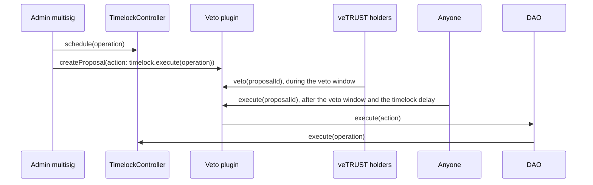

# Governance

Contract upgrades and configuration changes on Intuition Mainnet go through two timelocks: the Upgrades TimelockController and the Parameters TimelockController. A governance DAO holds the executor role on both, and veTRUST holders can veto any change the DAO would execute.

The model is optimistic. The admin multisig proposes a change, and the change can execute unless veTRUST holders veto it.

| Role                                     | Holder                                                   |
| ---------------------------------------- | -------------------------------------------------------- |
| Creates proposals                        | The admin multisig (4 of 8 signatures)                   |
| Can veto                                 | Any address that held veTRUST at the proposal's snapshot |
| Executes a proposal that was not vetoed  | Anyone, through the veto plugin                          |
| Executor on both timelocks               | The governance DAO and the admin multisig                |
| Proposer and canceller on both timelocks | The admin multisig                                       |

:::caution The admin multisig can still execute directly
The admin multisig keeps its executor, proposer and canceller roles on both timelocks. It can execute a scheduled change without a proposal, and a veto does not cancel the scheduled change on the timelock. A veto blocks only the governance path, so it is advisory for as long as the multisig holds the executor role.
:::

## How a proposal moves



1. The admin multisig schedules the change on one of the timelocks. The timelock delay starts.
2. The multisig creates a proposal on the veto plugin. The proposal's action is the `execute` call on the timelock for that exact operation. The voting-power snapshot is taken one second before the proposal is created.
3. During the veto window, any address that held veTRUST at the snapshot can call `veto(proposalId)` on the plugin.
4. If the vetoes reach the threshold, the proposal can never execute.
5. Otherwise, after the veto window has ended and the timelock delay has passed, anyone can call `execute(proposalId)` on the plugin. The plugin has the DAO run the action, and the DAO, as an executor, runs the timelocked operation.

A proposal waits for the longer of its veto window and its timelock delay. On the Parameters TimelockController the delay is 3 days, but a proposal still waits for its full veto window.

## Current settings

| Setting                             | Value                                                        |
| ----------------------------------- | ------------------------------------------------------------ |
| Veto threshold                      | 50% of total veTRUST voting power at the proposal's snapshot |
| Minimum veto window                 | 7 days                                                       |
| Voting-power snapshot               | One second before the proposal is created                    |
| Upgrades TimelockController delay   | 7 days                                                       |
| Parameters TimelockController delay | 3 days                                                       |

The veto settings can be changed only through a proposal that is not vetoed.

### Voting power

- Your veto weight is your veTRUST balance in [TrustBonding](/docs/intuition-smart-contracts/trust-bonding) at the proposal's snapshot. veTRUST decays as a lock approaches its end, so the balance at the snapshot is what counts.
- Locking or adding TRUST after the snapshot does not count for that proposal.
- veTRUST cannot be delegated. A lock held by a contract vetoes by calling `veto` from that contract. A contract can lock only if the admin multisig has allowed it.
- Each address can veto a proposal once. A veto cannot be withdrawn.
- The threshold is measured against total veTRUST at the snapshot, not against the veTRUST that takes part. An address that does not veto counts the same as one that supports the proposal.

## What goes through governance

- **Contract upgrades.** The Upgrades TimelockController owns the proxy admins of the protocol contracts and the atom wallet beacon.
- **Configuration changes.** The Parameters TimelockController is the only address that can change MultiVault's configuration and TrustBonding's parameters. See [Configurations & Fees](/docs/intuition-smart-contracts/configuration).
- **The governance contracts themselves.** Upgrading the DAO or the veto plugin, or changing the veto settings, needs a proposal that is not vetoed. No address holds these permissions directly.

## What stays outside governance

These powers do not go through a proposal:

- The admin multisig can execute timelocked changes directly, as described above.
- Pausing is instant. On MultiVault, TrustBonding, AtomWarden and FeeProxy, the admin multisig can pause and unpause.
- The BondingCurveRegistry owner registers new bonding curves directly.
- On TrustBonding, the admin multisig can end all locks at once, making every lock withdrawable, and it decides which contracts can lock.
- The admin multisig holds admin roles with no delay on AtomWarden and SatelliteEmissionsController, and sets FeeProxy's fee caps and registration fee.
- Governance runs on Intuition Mainnet only. The contracts on Base, including the Trust token, BaseEmissionsController and their Upgrades TimelockController, are outside it.
- Caldera operates the Intuition chain and the TRUST bridge.

## How to veto

You need veTRUST at the proposal's snapshot and a tool that can call contract functions. The examples use [Foundry's `cast`](https://book.getfoundry.sh/cast/) and the public RPC.

```bash
RPC=https://rpc.intuition.systems/http
PLUGIN=0x013d36E344ce912440Bc615f774fAD73F7d62c3D
ADAPTER=0x83d2c9D0fc344598166533dd306034ae8E75bD0f
```

### 1. Find the proposal

Proposal IDs are not sequential numbers: each ID encodes the proposal's start and end times. The plugin keeps a list, and each new proposal also emits `ProposalCreated`.

```bash
cast call $PLUGIN "proposalCount()(uint256)" --rpc-url $RPC
cast call $PLUGIN "proposalIds(uint256)(uint256)" 0 --rpc-url $RPC   # the first proposal's ID
```

### 2. Read the proposal

```bash
cast call $PLUGIN \
  "getProposal(uint256)(bool,bool,(uint64,uint64,uint32,bool),uint256,bytes,(address,uint256,bytes)[],uint256)" \
  $PROPOSAL_ID --rpc-url $RPC
```

The fields are, in order: open, executed, (veto end time, snapshot timestamp, veto ratio, an L2 flag that is unused here), veto tally, metadata, actions and failure map. Each action is (target, value, call data).

### 3. Check what the proposal would do

A proposal can hold any call the DAO can make, so decode every action and check its target. Check that the failure map is 0, which means every action must succeed.

For a timelocked change, the action's target is one of the timelocks, and its call data is the timelock's `execute` call. Decode it:

```bash
cast calldata-decode "execute(address,uint256,bytes,bytes32,bytes32)" $ACTION_DATA
```

This gives the operation's target, value, payload, predecessor and salt. Confirm that the timelock has the operation scheduled and when it becomes ready, then decode the payload to see the change itself. Take the function signature from the target's verified ABI on the explorer:

```bash
cast call $TIMELOCK "hashOperation(address,uint256,bytes,bytes32,bytes32)(bytes32)" \
  $TARGET $VALUE $PAYLOAD $PREDECESSOR $SALT --rpc-url $RPC        # the operation ID
cast call $TIMELOCK "getTimestamp(bytes32)(uint256)" $OPERATION_ID --rpc-url $RPC
cast calldata-decode "<function signature>" $PAYLOAD
```

`cast 4byte-decode $PAYLOAD` is a shortcut, but its public signature database does not know every protocol function. If the action calls `executeBatch`, decode it with `"executeBatch(address[],uint256[],bytes[],bytes32,bytes32)"` and use `hashOperationBatch`.

### 4. Check your weight

```bash
cast call $PLUGIN "canVeto(uint256,address)(bool)" $PROPOSAL_ID $YOUR_ADDRESS --rpc-url $RPC
cast call $ADAPTER "getPastVotes(address,uint256)(uint256)" $YOUR_ADDRESS $SNAPSHOT_TIMESTAMP --rpc-url $RPC
```

`canVeto` returns false if the veto window has closed, you have already vetoed, or you held no veTRUST at the snapshot.

### 5. Veto

```bash
cast send $PLUGIN "veto(uint256)" $PROPOSAL_ID --rpc-url $RPC --account <your-keystore>
```

The plugin emits `VetoCast` with your address and weight.

### 6. Follow the result

```bash
cast call $PLUGIN "isMinVetoRatioReached(uint256)(bool)" $PROPOSAL_ID --rpc-url $RPC   # true: vetoed
cast call $PLUGIN "canExecute(uint256)(bool)" $PROPOSAL_ID --rpc-url $RPC
cast call $TIMELOCK "isOperationReady(bytes32)(bool)" $OPERATION_ID --rpc-url $RPC
```

`canExecute` checks only the veto side. A timelocked change executes only after the timelock operation is also ready.

## Contracts

All on Intuition Mainnet (chain ID 1155) and verified on the [explorer](https://explorer.intuition.systems).

| Contract                                  | Address                                                                                                                               |
| ----------------------------------------- | ------------------------------------------------------------------------------------------------------------------------------------- |
| DAO (governance)                          | [`0x9c965C3D39beb6293ca92cd35e552963e913F4Fd`](https://explorer.intuition.systems/address/0x9c965C3D39beb6293ca92cd35e552963e913F4Fd) |
| OptimisticTokenVotingPlugin (veto plugin) | [`0x013d36E344ce912440Bc615f774fAD73F7d62c3D`](https://explorer.intuition.systems/address/0x013d36E344ce912440Bc615f774fAD73F7d62c3D) |
| VeTrustVotesAdapter                       | [`0x83d2c9D0fc344598166533dd306034ae8E75bD0f`](https://explorer.intuition.systems/address/0x83d2c9D0fc344598166533dd306034ae8E75bD0f) |
| Upgrades TimelockController               | [`0x321e5d4b20158648dFd1f360A79CAFc97190bAd1`](https://explorer.intuition.systems/address/0x321e5d4b20158648dFd1f360A79CAFc97190bAd1) |
| Parameters TimelockController             | [`0x71b0F1ABebC2DaA0b7B5C3f9b72FAa1cd9F35FEA`](https://explorer.intuition.systems/address/0x71b0F1ABebC2DaA0b7B5C3f9b72FAa1cd9F35FEA) |
| TrustBonding (veTRUST)                    | [`0x635bBD1367B66E7B16a21D6E5A63C812fFC00617`](https://explorer.intuition.systems/address/0x635bBD1367B66E7B16a21D6E5A63C812fFC00617) |
| Admin multisig (Safe, 4 of 8)             | [`0xbeA18ab4c83a12be25f8AA8A10D8747A07Cdc6eb`](https://explorer.intuition.systems/address/0xbeA18ab4c83a12be25f8AA8A10D8747A07Cdc6eb) |

The DAO and the veto plugin are ERC-1967 proxies. VeTrustVotesAdapter is a small read-only contract that reports veTRUST balances from TrustBonding at past times in the votes interface the plugin reads.

## Sources and audits

- The veto plugin is Taiko's `OptimisticTokenVotingPlugin`, deployed unchanged from commit [`939b67a`](https://github.com/taikoxyz/dao-contracts/tree/939b67a60ddfd65198ba86e126d08da3e45ef2e4). Halborn audited it: [report](https://www.halborn.com/audits/taiko/taiko-dao-contracts-44391c).
- The DAO is Aragon OSx v1.3.0, deployed unchanged from commit [`e90ea8f`](https://github.com/aragon/osx/tree/e90ea8f5cd6b98cbba16db07ab7bc0cdbf517f3e). Halborn audited it: [report](https://github.com/aragon/osx/blob/852d802375ba9c862cffdca38dc88b735127d47d/audits/Halborn_AragonOSx_2023-06-13.pdf).
