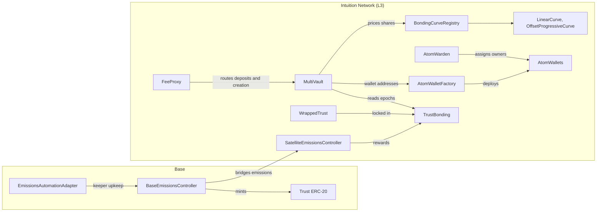

# Contract Architecture Overview

Intuition's smart contracts are central to the user experience, handling critical onchain activities such as the creation of Atoms (also known as Identities) and Triples (also known as Claims), as well as the staking and rewards.

The contracts live on two chains:

- **Intuition Network (L3):** the protocol itself (MultiVault, the bonding curves, atom wallets, TrustBonding and the emissions receiver) and the periphery contracts built on it.
- **Base:** the TRUST token and the BaseEmissionsController, which mints new TRUST and bridges it to the Intuition Network.

| Group               | Contracts                                                                                |
| ------------------- | ---------------------------------------------------------------------------------------- |
| Core                | MultiVault, BondingCurveRegistry, LinearCurve, OffsetProgressiveCurve                    |
| Atom wallets        | AtomWalletFactory, AtomWallet (one per atom, behind a beacon), AtomWarden                |
| Token and emissions | Trust, WrappedTrust, TrustBonding, BaseEmissionsController, SatelliteEmissionsController |
| Governance          | Upgrades TimelockController, Parameters TimelockController                               |
| Periphery           | FeeProxy, EmissionsAutomationAdapter                                                     |

All addresses are on the [Deployments](/docs/intuition-smart-contracts/deployments) page.

# MultiVault

The MultiVault contract is the core component of Intuition's architecture, responsible for managing the creation of Atoms/Triples and handling deposits, redemptions, and share distributions. It supports multiple bonding curve implementations through a registry system.

- **Creation**: Users can create Atoms and Triples, for themselves or, with a user's approval, on that user's behalf
- **Deposits**: Users can deposit TRUST to receive shares in atoms/triples
- **Redemptions**: Users can redeem shares for TRUST
- **Multi-Vault**: Supports multiple bonding curve implementations
- **Share Distribution**: Manages the minting and burning of shares
- **Fee Collection**: Collects small fees to maintain the system
- **Multicall**: Runs several MultiVault calls in one transaction (v1.1.0)

See [MultiVault.sol](/docs/intuition-smart-contracts/multivault) for details.

# Atom Wallets

Every atom has its own **AtomWallet**, an ERC-4337 smart account. Deposits into an atom's vaults pay a small atom wallet deposit fee, which accumulates for the atom's wallet and can be claimed by the wallet's owner.

- **AtomWalletFactory** computes each wallet's deterministic address and deploys the wallet on request. Anyone can deploy a wallet.
- **AtomWallet** is the smart account itself. All atom wallets share one implementation through an upgradeable beacon.
- **AtomWarden** owns every atom wallet until it is claimed, and hands ownership to the right account once. An account can claim the wallet of the atom for its own address, a claim can be signed by AtomWarden's signers, an atom's creator can claim after a waiting period, and an operator can grant ownership. See [Atom wallets and AtomWarden](/docs/intuition-smart-contracts/multivault#atom-wallets-and-atomwarden).

# Trust Token

The Trust Token contract is an ERC-20 compliant token that serves as the native utility token within the Intuition ecosystem. It is used for deposits, staking, governance, and accessing various features of the platform.

- **ERC-20 Compliance**: Fully compliant with the ERC-20 standard
- **Minting and Burning**: Controlled minting and burning of tokens
- **Transfers**: Standard token transfer functionality

The Trust Token contract is **deployed on Base** and is the **native gas token on the Intuition Network L3 chain**.

# Wrapped Trust

The Wrapped Trust contract is an ERC-20 compliant token that lives on the Intuition Network L3 chain. After users bridge their Trust tokens from Base to the Intuition Network L3 chain, they can receive Wrapped Trust tokens by depositing Trust tokens into the Wrapped Trust contract.

**Wrapped Trust tokens can be used for staking in the Trust Bonding contract.**

# Trust Bonding

The Trust Bonding contract is a smart contract introduced in V2. Inheriting from the Curve VotingEscrow contract, it enables staking of Wrapped Trust to earn rewards and participate in governance. Key features include:

- **Staking**: Users can stake Wrapped Trust to earn rewards
- **Locking**: Users can lock their stake for a specified duration to increase voting power
- **Rewards**: Users earn rewards based on their stake and lock duration
- **Governance**: Stakers can participate in governance decisions

# Bonding Curve Registry

The Bonding Curve Registry contract is a registry for bonding curve implementations. It allows the MultiVault contract to look up and use different bonding curve implementations. Key features include:

- **Registration**: The registry owner registers new bonding curve implementations, each under the next curve ID
- **Lookup**: The MultiVault contract can look up bonding curve implementations by ID
- **Management**: The registry can be managed by the contract owner

Two curves are registered: **LinearCurve** (curve ID 1, the default curve for new atoms and triples) and **OffsetProgressiveCurve** (curve ID 2). See [Configurations & Fees](/docs/intuition-smart-contracts/configuration#bonding-curves).

# BaseEmissionsController

The BaseEmissionsController contract is responsible for managing the emissions of Trust tokens. It controls the rate at which new Trust tokens are minted and distributed to stakers in the Trust Bonding contract. Key features include:

- **Emission Rate**: Controls the rate of Trust token emissions
- **Distribution**: Distributes newly minted Trust tokens to the SatelliteEmissionsController
- **Bridging**: Uses the Caldera MetaLayer protocol to bridge emissions to the Intuition Network L3 chain

# SatelliteEmissionsController

The SatelliteEmissionsController contract is responsible for managing the emissions of Trust tokens on the Intuition Network L3 chain. It receives emissions from the BaseEmissionsController and distributes them to stakers via the Trust Bonding contract. Key features include:

- **Receiving Emissions**: Receives Trust token emissions from the BaseEmissionsController
- **Distribution**: Distributes Trust tokens to stakers via the Trust Bonding contract
- **Bridging/Burning**: Uses the Caldera MetaLayer protocol to bridge/burn emissions back to Base

# Governance

The protocol contracts are upgradeable, and two timelocks control changes to them:

- **Upgrades TimelockController** owns the proxy admins and the atom wallet beacon. A contract upgrade can run only after the timelock's delay (7 days on mainnet).
- **Parameters TimelockController** is, from v1.1.0, the only address that can change MultiVault's configuration: the general, atom, triple, wallet, fee and bonding curve settings, and the atom URI limits. Any other caller gets `MultiVault_OnlyTimelock`. A change can run only after the timelock's delay (3 days on mainnet).

On mainnet, a multisig proposes every timelocked change, so each change is public on-chain for the whole delay before it takes effect. Pausing does not go through the timelocks: on MultiVault, a `PAUSER_ROLE` holder can pause, and only the admin can unpause.

# Periphery

Periphery contracts provide auxiliary functions around the core protocol, such as routing deposits with an app's fee or minting emissions. Users can always use the core contracts directly.

## FeeProxy

The FeeProxy contract, introduced in v1.1.0, lets apps (affiliates) route a user's deposits and atom/triple creation to the MultiVault and charge their own fee. The user stays the creator of record and receives the shares; on deposits, MultiVault's `Deposited` event records FeeProxy as the sender, and FeeProxy's own events record the user. Redemptions always go directly to the MultiVault. See [FeeProxy.sol](/docs/intuition-smart-contracts/fee-proxy) for details.

- **Affiliate Registration**: Any address can register as an affiliate and set its fees within protocol caps
- **Fee Routing**: Takes the affiliate fee from each routed call and forwards the rest to the MultiVault
- **User Protection**: A per-call fee guard, atomic calls, and refunds of excess value
- **Analytics**: Per-affiliate and per-user usage counters stored on-chain

## EmissionsAutomationAdapter

The EmissionsAutomationAdapter contract on Base is the contract that automation keepers call to start each epoch's emissions. For each epoch, it mints that epoch's TRUST and bridges it to the Intuition Network through the BaseEmissionsController.

- **Keeper-only**: Only an address with `UPKEEP_ROLE` can call `performUpkeep`
- **Once per epoch**: `checkUpkeep` reports whether the current epoch is still unminted, and `performUpkeep` does nothing for an epoch that is already minted
- **Pausable**: The admin can pause and unpause it, which stops automated minting without changing the BaseEmissionsController

Integrators do not call this contract. It emits `UpkeepPerformed(epochNumber)` on Base each time it mints an epoch.
