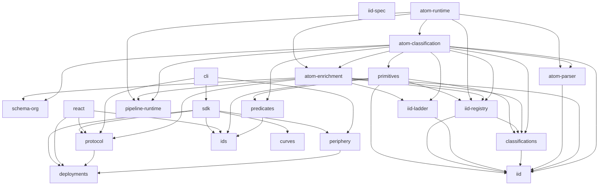

<AppliesTo />

These stable packages separate vocabulary, identity, local construction, processing, and protocol operations. Each reference lists its exact install pin, public entry points, runtime dependencies, and peers. Start with [installation](/docs/build/install) or the [offline quickstart](/docs/get-started/quickstart).

An atom ID identifies exact bytes; an IID names an entity; a triple explicitly relates three atom IDs. Local construction does not create on-chain terms. Indexed V2 graph reads use the [Query API of a Core node you run](/docs/build/query-core).

## Semantic / data modeling

| Package                                                       | Use it to                                                       |
| ------------------------------------------------------------- | --------------------------------------------------------------- |
| [`schema-org`](/docs/reference/packages/schema-org)           | Inspect pinned schema vocabulary and inherited properties.      |
| [`classifications`](/docs/reference/packages/classifications) | Select entity specs, creation fields, and relationship targets. |
| [`predicates`](/docs/reference/packages/predicates)           | Select relationship vocabulary and deterministic predicate IDs. |

## Identity

| Package                                                 | Use it to                                              |
| ------------------------------------------------------- | ------------------------------------------------------ |
| [`iid-spec`](/docs/reference/packages/iid-spec)         | Read specification artifacts and conformance fixtures. |
| [`iid`](/docs/reference/packages/iid)                   | Parse, canonicalize, and derive identifier strings.    |
| [`iid-registry`](/docs/reference/packages/iid-registry) | Map identifiers to meanings and provider plans.        |
| [`iid-ladder`](/docs/reference/packages/iid-ladder)     | Select a primary identifier from supplied evidence.    |
| [`ids`](/docs/reference/packages/ids)                   | Hash atom bytes and ordered triple components.         |

## Builder helpers

| Package                                             | Use it to                                           |
| --------------------------------------------------- | --------------------------------------------------- |
| [`primitives`](/docs/reference/packages/primitives) | Build validated atom and triple blueprints offline. |

## Pipeline runtime

| Package                                                         | Use it to                                                    |
| --------------------------------------------------------------- | ------------------------------------------------------------ |
| [`pipeline-runtime`](/docs/reference/packages/pipeline-runtime) | Coordinate concurrency, cancellation, and provider policies. |

## Atom processing

| Package                                                               | Use it to                                                     |
| --------------------------------------------------------------------- | ------------------------------------------------------------- |
| [`atom-parser`](/docs/reference/packages/atom-parser)                 | Detect and normalize inputs, with optional remote inspection. |
| [`atom-classification`](/docs/reference/packages/atom-classification) | Assign classifications through explicit plugin sets.          |
| [`atom-enrichment`](/docs/reference/packages/atom-enrichment)         | Execute providers and extract metadata with provenance.       |
| [`atom-runtime`](/docs/reference/packages/atom-runtime)               | Compose parsing, classification, and enrichment.              |

## Application integration

| Package                               | Use it to                                                      |
| ------------------------------------- | -------------------------------------------------------------- |
| [`sdk`](/docs/reference/packages/sdk) | Prepare typed action plans, quotes, and contract transactions. |
| [`cli`](/docs/reference/packages/cli) | Inspect encoders and generate calldata from a terminal.        |

## Protocol plumbing

| Package                                               | Use it to                                                 |
| ----------------------------------------------------- | --------------------------------------------------------- |
| [`protocol`](/docs/reference/packages/protocol)       | Encode and call protocol contracts.                       |
| [`deployments`](/docs/reference/packages/deployments) | Select contract artifacts, addresses, and chain metadata. |
| [`periphery`](/docs/reference/packages/periphery)     | Use FeeProxy, router, and bridge helpers.                 |
| [`curves`](/docs/reference/packages/curves)           | Calculate curve results from supplied state.              |
| [`react`](/docs/reference/packages/react)             | Use protocol hooks and transaction state in React.        |

## Runtime dependencies

An arrow points from a package to its direct runtime dependency. The graph shows the package-to-package edges in the pinned architecture source; external peer requirements are listed on each package page. `iid-spec` has no runtime edges.

## Source

[Package layers](https://github.com/0xIntuition/packages/blob/4e9af1373b81a453d16bc650983138e35afb97d1/README.md#package-layers) · [Package map](https://github.com/0xIntuition/packages/blob/4e9af1373b81a453d16bc650983138e35afb97d1/docs/architecture/package-map.md) · [Runtime dependency graph](https://github.com/0xIntuition/packages/blob/4e9af1373b81a453d16bc650983138e35afb97d1/docs/architecture/dependency-graph.md).
