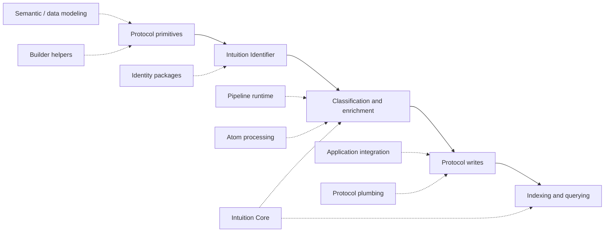

Protocol primitives is ladder Tier 1, Intuition Identifier is Tier 2 (Identity), Classification and enrichment spans Tiers 3 and 4 (Meaning, Processing), and Protocol writes and Indexing and querying are Tier 5 (Data flow).
